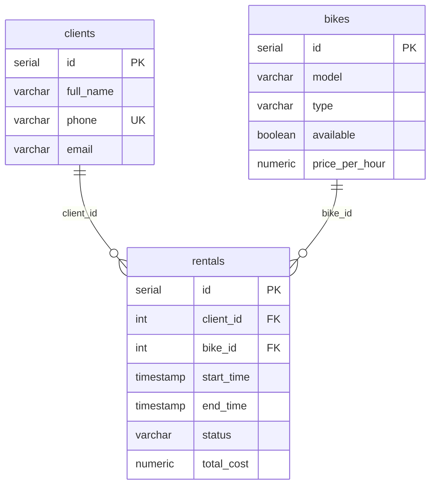

# Система проката велосипедов (Velik)

Консольная информационная система на Java для управления прокатом велосипедов.

**Предметная область:** прокат велосипедов, основная сущность: заявка на аренду (`Rental`)
**СУБД:** PostgreSQL
**Вариант КР1 МИРЭА**

## Архитектура

```
Console UI (Main)
    ↓
Service (бизнес-логика + проверки)
    ↓
Repository / JDBC (PreparedStatement)
    ↓
PostgreSQL
```

Слои не перепрыгивают друг через друга. В `Main` нет ни SQL, ни JDBC: консоль вызывает только сервисы.

### Структура проекта

```
Velik/
├── pom.xml
├── schema.sql                    — создание таблиц + тестовые данные
├── README.md
├── docs/
│   └── er-diagram.png / .svg     — ER-диаграмма
└── src/main/java/ru/mirea/velik/
    ├── Main.java                 — консольное меню (UI) и сборка зависимостей
    ├── model/
    │   ├── Client.java           — клиент
    │   ├── Bike.java             — велосипед
    │   ├── Rental.java           — основная сущность (заявка на аренду)
    │   └── RentalStatus.java     — enum статусов
    ├── repository/
    │   ├── Repository.java       — обобщённый интерфейс CRUD (полиморфизм)
    │   ├── ClientRepository.java, BikeRepository.java, RentalRepository.java
    │   └── JdbcClientRepository.java, JdbcBikeRepository.java, JdbcRentalRepository.java
    ├── service/
    │   └── ClientService.java, BikeService.java, RentalService.java
    ├── exception/
    │   └── BusinessException.java, EntityNotFoundException.java, DatabaseException.java
    └── util/
        ├── DatabaseManager.java  — подключение к БД, проверка связи, список таблиц
        └── ExcelExporter.java    — экспорт в .xlsx (Apache POI)
```

## Требования

- JDK 17+
- Maven 3.6+
- PostgreSQL 14+

## Быстрый старт

### 1. Создание базы данных

```bash
psql -U postgres -c "CREATE DATABASE velik ENCODING 'UTF8';"
psql -U postgres -d velik -f schema.sql
```

Или выполните содержимое `schema.sql` в pgAdmin / DBeaver после создания БД `velik`.
Скрипт можно запускать повторно: он пересоздаёт таблицы и тестовые данные.

### 2. Параметры подключения

По умолчанию: `jdbc:postgresql://localhost:5432/velik`, пользователь `postgres`, пароль `postgres`.

Переопределяются переменными окружения:

```bash
export DB_URL="jdbc:postgresql://localhost:5432/velik"
export DB_USER="postgres"
export DB_PASSWORD="ваш_пароль"
```

(в PowerShell: `$env:DB_PASSWORD="ваш_пароль"`), либо системными свойствами Java:
`-Ddb.url=... -Ddb.user=... -Ddb.password=...`

### 3. Сборка и запуск

Из консоли, в папке проекта:

```bash
mvn clean package
java -jar target/velik-1.0-SNAPSHOT.jar
```

**IntelliJ IDEA:** откройте папку как Maven-проект, дождитесь загрузки зависимостей, откройте
*Run → Edit Configurations*, у конфигурации `ru.mirea.velik.Main` задайте *Environment variables*
`DB_PASSWORD=ваш_пароль` и запустите.

**VS Code:** в `.vscode/launch.json` у конфигурации с `mainClass: ru.mirea.velik.Main` добавьте
`"console": "integratedTerminal"` (нужно для ввода с клавиатуры) и `"env": { "DB_PASSWORD": "ваш_пароль" }`.
Запускайте через панель *Run and Debug* (F5).

Если подключиться не удалось, программа выведет сообщение «КРИТИЧЕСКАЯ ОШИБКА» с URL и причиной
и завершится без стектрейса.

## Главное меню

```
========================================
       СИСТЕМА ПРОКАТА ВЕЛОСИПЕДОВ
========================================
1. Клиенты
2. Велосипеды
3. Аренда (заявки)
4. Поиск
5. Фильтрация
6. Статистика
7. Экспорт данных
8. Вывести таблицы базы данных
0. Выход
```

Меню «Аренда (заявки)»: создать заявку, показать все, показать по ID, изменить клиента/велосипед,
изменить статус, удалить, сортировка по дате начала, сортировка по стоимости.

## Бизнес-правила (реализованы в Service)

1. ФИО и телефон клиента обязательны (телефон не короче 5 символов, email содержит `@`).
2. Модель и тип велосипеда обязательны, цена за час должна быть больше 0.
3. Нельзя создать аренду на несуществующего клиента или велосипед.
4. Нельзя арендовать недоступный велосипед или велосипед, у которого уже есть активная аренда.
5. Запрещены недопустимые переходы статусов:
   - CREATED → ACTIVE / CANCELLED
   - ACTIVE → COMPLETED / CANCELLED
   - COMPLETED / CANCELLED — конечные статусы
6. Нельзя удалить клиента или велосипед, у которых есть аренды в статусах CREATED / ACTIVE.
7. Нельзя удалить ACTIVE-аренду и изменять завершённую или отменённую.
8. Нельзя вручную пометить велосипед «доступным», пока у него есть незавершённая аренда.
9. При смене велосипеда в заявке старый освобождается, новый занимается (и должен быть свободен).
10. Время аренды отсчитывается с момента выдачи (переход в ACTIVE). При завершении стоимость
    считается автоматически: число начатых часов (минимум 1) × цена за час.

## Поиск (регистр не важен)

- Клиенты по ФИО (часть строки) и по телефону
- Велосипеды по модели (часть строки)
- Аренды по клиенту и по велосипеду

## Фильтрация

- Велосипеды по типу, только доступные велосипеды
- Аренды по статусу, по диапазону дат начала

## Сортировка

- Клиенты: по ФИО, по ID (убыв.)
- Велосипеды: по цене (возр. / убыв.)
- Аренды: по дате начала, по стоимости (убыв.)

## Статистика

Всего клиентов, всего велосипедов, доступных велосипедов, всего заявок,
разбивка заявок по четырём статусам (`Map<RentalStatus, Long>`), общая выручка.

## Экспорт

Пункт меню 7 создаёт Excel-файл `.xlsx` с листами «Клиенты», «Велосипеды», «Аренды».
Пример экспортированного файла для сдачи положите в `docs/velik_export.xlsx`.

## Обработка ошибок

Программа не завершается аварийно при: тексте вместо числа, несуществующем ID, нарушении
бизнес-правил, неверной дате или статусе, недоступной БД и ошибках SQL (например, дубликат телефона),
ошибке записи файла и закрытии потока ввода (Ctrl+D / Ctrl+Z).

## ER-диаграмма



