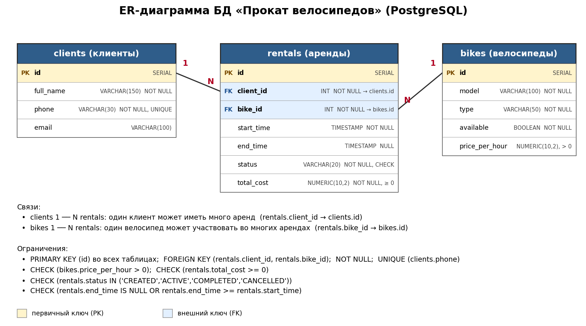
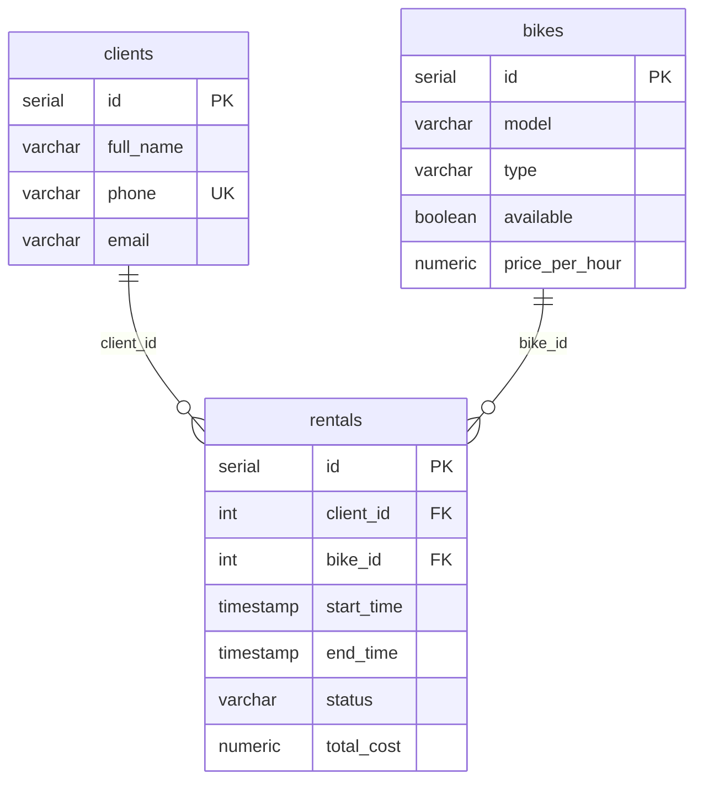

# Система проката велосипедов (Velik)

Настольное JavaFX-приложение для управления прокатом велосипедов.
Контрольная работа №2 — продолжение КР №1 (консольное приложение и база данных).

**Предметная область:** прокат велосипедов, основная сущность: заявка на аренду (`Rental`)
**СУБД:** PostgreSQL, база данных из КР №1 (`schema.sql`)
**Технологии:** Java 21, JavaFX 21, Maven, FXML, CSS, JDBC, Apache POI

## Архитектура

```
View (FXML + CSS)
    ↓
Controller (обработка действий пользователя)
    ↓
Service (бизнес-правила и проверки)
    ↓
Repository / JDBC (PreparedStatement)
    ↓
PostgreSQL
```

Слои не перепрыгивают друг через друга: в контроллерах нет SQL и JDBC, они вызывают только сервисы.
JavaFX-приложение подключается к PostgreSQL напрямую через JDBC, без REST API.

### Структура проекта

```
Velik/
├── pom.xml
├── schema.sql                        — создание таблиц + тестовые данные
├── docker-compose.yml                — PostgreSQL с базой velik в Docker (необязательно)
├── docs/er-diagram.png / .svg        — ER-диаграмма
└── src/
    ├── main/java/ru/mirea/velik/
    │   ├── fx/
    │   │   ├── VelikApplication.java — класс JavaFX-приложения (Stage, Scene)
    │   │   ├── Launcher.java         — точка входа для IDE и JAR
    │   │   ├── AppContext.java       — сборка репозиториев и сервисов
    │   │   ├── ViewLoader.java       — загрузка FXML, фабрика контроллеров
    │   │   ├── controller/
    │   │   │   ├── MainController.java        — главное окно, вкладки
    │   │   │   ├── RentalsController.java     — заявки: таблица, CRUD, фильтры, экспорт
    │   │   │   ├── RentalFormController.java  — форма заявки
    │   │   │   ├── DirectoryController.java   — общая логика справочников
    │   │   │   ├── ClientsController.java, ClientFormController.java
    │   │   │   ├── BikesController.java, BikeFormController.java
    │   │   │   ├── FormController.java        — общая логика форм (ошибки, подсветка полей)
    │   │   │   └── StatisticsController.java
    │   │   └── util/                 — Alerts, FormDialog, UiActions, Cells, Combos, InputParser
    │   ├── model/                    — Client, Bike, Rental, RentalStatus, RentalView, Statistics
    │   ├── repository/               — интерфейсы и JDBC-реализации (DAO)
    │   ├── service/                  — ClientService, BikeService, RentalService,
    │   │                               StatisticsService, ExportService, RentalFilter
    │   ├── exception/                — BusinessException, ValidationException,
    │   │                               EntityNotFoundException, DatabaseException
    │   ├── util/                     — DatabaseManager, Formats, ExcelExporter
    │   └── Main.java                 — консольное приложение КР №1 (оставлено для сравнения)
    ├── main/resources/
    │   ├── database.properties       — параметры подключения к БД
    │   ├── fxml/                     — main, rentals, clients, bikes, statistics, формы
    │   └── css/app.css               — оформление
    └── test/java/                    — unit-тесты фильтра и статистики
```

## Требования

- JDK 21
- Maven 3.9+
- PostgreSQL 14+ (локальный или в Docker)

## Быстрый старт

### 1. База данных

**Вариант А — локальный PostgreSQL:**

```bash
psql -U postgres -c "CREATE DATABASE velik ENCODING 'UTF8';"
psql -U postgres -d velik -f schema.sql
```

**Вариант Б — PostgreSQL в Docker:**

```bash
docker compose up -d --wait
```

Контейнер публикует порт `5433`; `schema.sql` выполняется автоматически при первом запуске.

Скрипт `schema.sql` можно запускать повторно: он пересоздаёт таблицы и тестовые данные.

### 2. Параметры подключения

Файл `src/main/resources/database.properties`:

```properties
db.url=jdbc:postgresql://localhost:5432/velik
db.user=postgres
db.password=postgres
```

Укажите фактические порт, пользователя и пароль (для варианта с Docker — порт `5433`).
Не меняя файл, значения можно переопределить переменными окружения `DB_URL`, `DB_USER`, `DB_PASSWORD`
или системными свойствами Java `-Ddb.url=... -Ddb.user=... -Ddb.password=...`.

### 3. Запуск

```bash
mvn javafx:run
```

Остальные команды:

```bash
mvn clean compile
mvn test
mvn clean package
```

**IntelliJ IDEA:** откройте папку как Maven-проект и запустите класс `ru.mirea.velik.fx.Launcher`
либо цель `javafx:run` в панели Maven.

Если база данных недоступна, приложение покажет окно с причиной и адресом подключения и завершится.

## Возможности

### Главное окно

Вкладки «Заявки на аренду», «Клиенты», «Велосипеды», «Статистика». Кнопка «Обновить данные»
перечитывает текущую вкладку из базы, кнопка «Статистика» открывает раздел статистики.
При переходе между вкладками данные обновляются автоматически.

### Заявки на аренду (основная сущность)

- таблица `TableView`: номер, клиент, телефон, велосипед, тип, начало, окончание, статус, стоимость;
- добавление и изменение через форму: клиент и велосипед выбираются из `ComboBox`
  (в списке только свободные велосипеды), дата — `DatePicker`, время — поле `ЧЧ:ММ`;
- удаление с подтверждением;
- смена статуса: «Выдать велосипед», «Завершить аренду», «Отменить заявку»;
- панель сведений справа: данные заявки, связанного клиента и велосипеда;
- двойной щелчок по строке открывает форму изменения.

### Поиск, фильтрация, сортировка

- поиск по ФИО клиента, телефону, модели велосипеда и номеру заявки (регистр не важен);
- фильтры: статус, тип велосипеда, период дат начала аренды;
- сортировка: список готовых вариантов (дата, стоимость, клиент, статус) или щелчок по заголовку столбца.

Схема работы: `ObservableList` → `FilteredList` (условие `RentalFilter`) → `SortedList`
(компаратор привязан к таблице) → `TableView`.

### Клиенты и велосипеды

Полный CRUD, поиск, сортировка по столбцам. Справа — список аренд выбранного клиента или велосипеда.

### Статистика

Всего заявок, выручка, средний чек, минимальный и максимальный чек, средняя длительность аренды,
доля завершённых заявок, число клиентов, свободные велосипеды, самый востребованный тип,
число заявок и выручка за выбранный период, диаграмма заявок по статусам.

### Экспорт

Кнопка «Экспорт…» на вкладке заявок сохраняет **текущий набор** (с учётом поиска, фильтров и сортировки)
в `.xlsx` или `.csv`. Место сохранения выбирается через `FileChooser`.

## Проверка ввода

Проверки выполняются в сервисах; форма показывает текст ошибки и подсвечивает неверное поле.

| Что проверяется | Где |
|---|---|
| Обязательные поля (ФИО, телефон, модель, тип, цена, клиент, велосипед, дата, время) | сервисы, `InputParser` |
| Длина строк по размерам столбцов БД (ФИО ≤ 150, телефон 5–30, email ≤ 100, модель ≤ 100, тип ≤ 50) | `ClientService`, `BikeService` |
| Формат телефона и email | `ClientService` |
| Уникальность телефона клиента | `ClientService` |
| Цена — число, больше 0 и не больше 100 000 | `InputParser`, `BikeService` |
| Время в формате `ЧЧ:ММ`; дата начала не в прошлом и не дальше 30 дней | `InputParser`, `RentalService` |
| Период фильтра и статистики: дата «с» не позже даты «по» | `RentalsController`, `StatisticsService` |
| Существование клиента и велосипеда, доступность велосипеда | `RentalService` |

## Бизнес-правила (реализованы в Service)

1. ФИО и телефон клиента обязательны, телефон уникален.
2. Модель и тип велосипеда обязательны, цена за час должна быть больше 0.
3. Нельзя создать аренду на несуществующего клиента или велосипед.
4. Нельзя арендовать недоступный велосипед или велосипед, у которого уже есть активная аренда.
5. Допустимые переходы статусов:
   - CREATED → ACTIVE / CANCELLED
   - ACTIVE → COMPLETED / CANCELLED
   - COMPLETED / CANCELLED — конечные статусы
6. Нельзя удалить клиента или велосипед, у которых есть аренды в статусах CREATED / ACTIVE.
7. Нельзя удалить ACTIVE-аренду и изменять завершённую или отменённую.
8. Нельзя вручную пометить велосипед «доступным», пока у него есть незавершённая аренда.
9. При смене велосипеда в заявке старый освобождается, новый занимается (и должен быть свободен).
10. В заявке задаётся плановое время начала; фактическое время отсчитывается с момента выдачи
    (переход в ACTIVE). При завершении стоимость считается автоматически:
    число начатых часов (минимум 1) × цена за час.

## Обработка ошибок

- `ValidationException` — неверно заполнено поле: сообщение в форме и подсветка поля;
- `BusinessException`, `EntityNotFoundException` — нарушение бизнес-правила: окно-предупреждение;
- `DatabaseException` — ошибка БД: окно с понятным текстом, подробности в журнале (SLF4J);
- ошибка записи файла при экспорте — окно с причиной;
- стек-трейсы пользователю не показываются.

## ER-диаграмма




